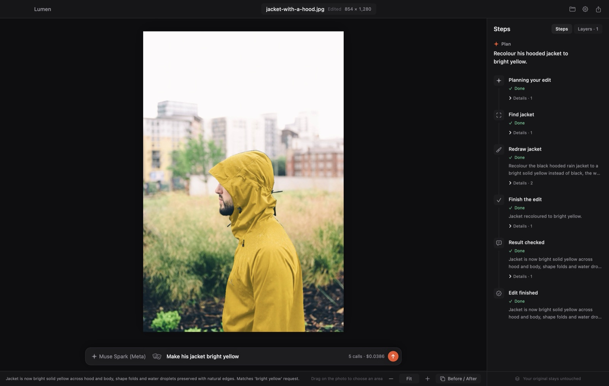
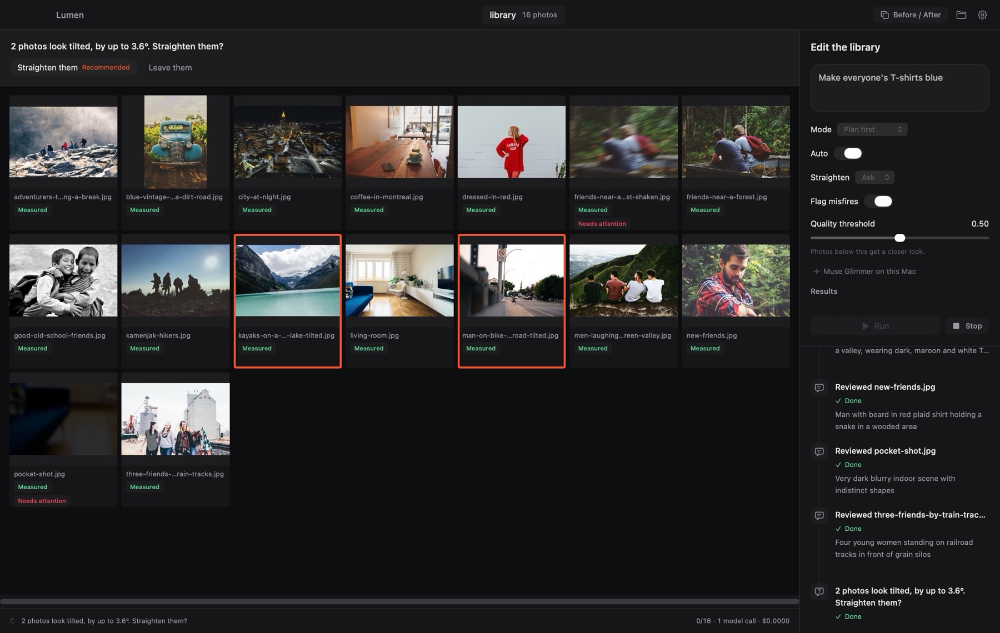
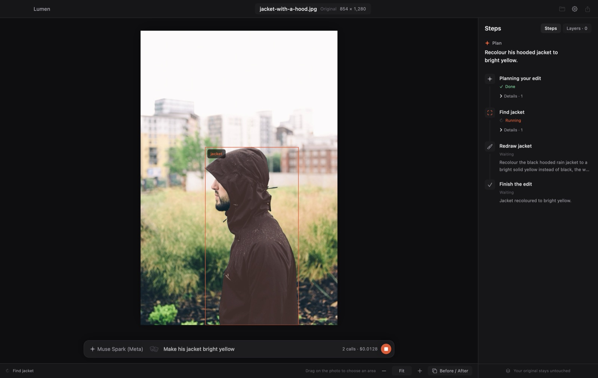

# Lumen

Lumen edits photos from a sentence, one photo or a whole shoot. You describe the change: "make the sky moodier and turn his coat navy". Lumen plans the steps, finds each region and makes the change. It then looks at its own result and revises it until the instruction is met.

Or point it at a folder of a thousand photos and say "edit them all, and make everyone's T-shirts blue". Lumen reviews the whole library, flags the misfires, applies auto and straightening, gives the weakest photos a closer look, and plans the instruction across the shoot, asking you only what is yours to decide.

- **Planning and checking:** Muse Spark; Muse Wonder plans across a library.
- **Finding things:** SAM 3.1 finds them by name, by a box you draw, or by points.
- **Redrawing:** Muse Image redraws what's inside a region.
- **Listening:** Muse Voice Transcribe writes down an instruction you say, in your own language, for you to check before it runs.

It also restyles a person, redrawing only them: a chad face, Day of the Dead face paint, a knight's armour, 30 years older and more.

Every step is a separate, non-destructive layer. You can turn any of them off, adjust them or undo them, and the original photo is never changed.

Lumen is a Swift package with a command-line tool (`lumen`) and a small Mac app (Lumen Studio).



## What existed before, and what is new

Lumen is new work, started on October 26, 2026 for the Meta AI Developer Hackathon. Everything in this repository was written during the event.

Lumen is also the agent inside Photoeditor, a native macOS photo editor that existed before the hackathon. Photoeditor is closed source and is not part of this repository. Photoeditor uses Lumen through the same public interfaces as Lumen Studio.

## How it works

1. **Plan.** Muse Spark reads the instruction and the photo, with any area you drew, and writes a plan in a strict JSON schema: select, adjust, regenerate, remove, style, crop, revert, finish. Lumen checks the plan before acting on it: values are clamped and steps that use unknown regions or layers are dropped, each with a note.
2. **Find.** SAM 3.1 looks for each region by name. The planner's box only chooses among what SAM found. When a name finds nothing (SAM finds no "gate" in a street-market photo, only its pillars and roof), Lumen asks again with the planner's box as SAM's own prompt.
3. **Change.**
   - Tone and colour changes are adjustment layers through the region's mask, fitted to the photo's edges with a guided filter.
   - Changes to what something is or looks like are redrawn by Muse Image from a crop around the region. Small crops are upscaled first, because Muse Image keeps their layout better at its own scale. Muse Image takes no mask, so the prompt names the thing and where it is in the crop.
   - SAM then looks at the redraw: if the object moved or changed size, Lumen redraws once more and keeps the better attempt.
   - A removal gets a crop three times the thing's size, to fill its place from what is around it. SAM then looks for the thing again; if it is still there, Lumen tries once more.
   - A recolour shows through SAM's mask held to the photo's edges and grown over the rim or shade of the same colour, so no fringe of the old colour is left.
   - The patch is composited through the mask, with the generator's colour drift measured on a ring around the region and taken out.
   - A person can be restyled from a catalogue (`lumen styles`): a chad face, a beard, aviator shades, zombie make-up or Day of the Dead face paint, 30 years older, an athletic build, a vampire, a pirate captain, any costume you name and more, each redrawing only that person, with effects such as main character or vintage film. A style takes every part of the person it needs: an older face its neck and ears with it and the hands apart, in their own close-up, so the age doesn't stop at the jaw; a costume the clothes on the upper body and room above the head for a hat that isn't in the photo yet. The skin is found by the colour of the person's own face. A body's V-taper is a warp by an exact amount, since Muse Image barely changes a body's shape, with the shoulders and waist found down from the face, which never moves; when the build shows (no top, or a T-shirt), Muse Image redraws the chest, shoulders and arms evenly and its light and shade is laid on the warped photo, so every edge and print stays the photo's. A redrawn face gets the photo's own colour cast back. Reshaping and ageing are for adults only.
4. **Check.** Muse Spark compares the result with the photo before the instruction. It also gets each changed region's colour before and after, measured on the Mac (CIELAB lightness, chroma, hue and a name), so a change too slight to see or a "black" that is really charcoal is a number, not a guess from two small photos. Each redrawn region is shown close up, with any place where it lost its fine detail named, so a smear isn't missed. If something is missing or looks wrong, it writes the next steps; a redraw that went wrong is replaced, not stacked. Each revision with a redraw or a failure is checked again, within a step and revision budget.
5. **Remember.** Follow-ups ("a bit less", "undo that") reuse the regions and layers already made.

Every model call, plan, critique and failure is kept in a trace. [docs/evaluation.md](docs/evaluation.md) has the results on 15 CC0 photos.

An editor can also use the finding step on its own. `AreaSearch` looks for a name only inside a box the person drew, keeping what lies mostly inside it. When nothing by that name is there, it selects what the box frames, or the box itself when that comes back as a few specks. Photoeditor's Masks panel uses it: drag a box, type "cup", and only the cup inside the box is selected.

## A whole library

```sh
lumen batch shoot/ "Make everyone's T-shirts blue" --out edited/ --mode ask
```

1. **Look.** Every photo is measured on the Mac: sharpness, exposure, clipping, the horizon's tilt with Vision, and the lean of its long straight lines. Muse Spark then reviews numbered contact sheets of 20. For each photo it gives a misfire verdict, quality, description and group, says whether the instruction applies, and names the line that should be level, if any.
2. **Base pass.** Misfires (shaken frames, pocket shots) are flagged and left out. Everything else gets a gentle auto tone and colour. A photo is straightened only when its own walls and poles, or with none of those its horizon or shoreline, lean with the tilt Vision measured: perspective, a receding shore or a slope reads as tilt too, and is left alone.
3. **Closer look.** Photos still under the quality threshold get their own edit.
4. **The instruction.** Muse Wonder groups the photos it applies to and writes each photo's instruction. It asks what only you can decide ("the same blue shirt for everyone, or each keeps his style?"), with a recommendation. Then each photo is edited by its own agent, a few at a time.

There are three modes:

- **Autonomous:** takes every recommendation and records that it did.
- **Ask:** waits for your answers.
- **Plan first:** shows the plan and its estimated model calls, and changes nothing until you approve.

Results are written to a separate folder with a sidecar per photo, a summary of every answer and who gave it, and before and after contact sheets. The originals are never written. Lumen Studio has the same flow in its Library window (File › Open Folder).



## Models

| Task | Model | Where it runs |
| --- | --- | --- |
| Plan an instruction, judge the result, review a library | Muse Spark (`muse-spark-1.3`) | Meta Model API |
| Plan an instruction across a library | Muse Wonder (`muse-wonder-1.0`) | Meta Model API |
| Find regions | SAM 3.1 (`sam-3.1`) | Meta Model API |
| Redraw a region | Muse Image (`muse-image-1.0`) | Meta Model API |
| Write down a spoken instruction | Muse Voice Transcribe (`muse-voice-transcribe-1.0`) | Meta Model API |
| Plan and judge with open weights | Muse Spark Open | A hosting provider (Baseten or Modal) |
| Plan and judge on this Mac | Muse Glimmer | Locally through llama.cpp; measured on an M4 Max with 36 GB: about 33 s to load, 70–90 s per plan or check |

Lumen uses your own Meta API key. Set `META_API_KEY`, or enter it in Lumen Studio, which keeps it in the Keychain. No model weights are included here; each model is used under its own license. Lumen is an independent project: it is not made, affiliated with or endorsed by Meta, whose model names are trademarks of Meta Platforms, Inc.

### What an edit costs

Every model call is priced from Meta's published prices and recorded in the trace, and `lumen edit` prints the total. A one-photo edit costs about 3 cents:
- a plan and a check with Muse Spark;
- a SAM 3.1 selection, plus SAM's check of the redraw;
- one Muse Image redraw.

Measured on October 26, these kept that cost down:
- **Planner and critic photos at 1024 px.** Spark reads one as about 860 input tokens, against about 1,940 at 1536 px, and planned and judged as well; SAM still selects at 1536 px.
- **Fixed parts of the prompt first.** The rules and the photo come before the parts that change, so Meta's prompt cache can serve them when it applies.
- **No repeated SAM searches.** A repeated search on the same picture is answered from memory.

[docs/meta-api.md](docs/meta-api.md) has the measurements.

## Try it

With your own Meta API key, from a clone of this repository:

```sh
export META_API_KEY=…
swift build -c release
.build/release/lumen edit Fixtures/photos/jacket-with-a-hood.jpg "Make his jacket bright yellow" \
  --out yellow.jpg --trace yellow.json
```

What to expect:
- It takes about half a minute and five model calls, and costs about 3 cents. The command prints the cost, and `yellow.json` has every plan, call and check.
- A follow-up remembers the edit: run Lumen Studio, or see [Follow-ups and undo](docs/evaluation.md#follow-ups-and-undo).

For a whole library, plan-first mode shows the plan and waits for approval before changing anything:

```sh
.build/release/lumen batch Fixtures/library "Make everyone's T-shirts blue" --out results --mode plan
```

The last full run of this library, autonomous, took 42 model calls in 361 s and cost $0.52.

### Without a key

Two live edits are recorded in [`Samples/`](Samples/README.md), every answer the Meta models gave. Replayed, they run
the whole edit again on your Mac, with no key, no account and no cost, and make the same result:

```sh
.build/release/lumen edit Fixtures/photos/man-in-denim-jacket-posing.jpg "Dress the man up as a medieval knight" \
  --replay Samples/knight-costume.run.json --out knight.jpg
```

`swift test` also runs everything against recorded responses.

## Build

Requires macOS 26 and Xcode 26.

```sh
swift build
swift test
```

## Use it

- **Lumen Studio:** `scripts/build-studio.sh`, then open `.build/studio/Lumen Studio.app`. See [docs/studio.md](docs/studio.md), including how to open a build that isn't notarized.
- **The command:** `swift build -c release`, then `.build/release/lumen edit photo.jpg "Make the sky moodier"`, or `lumen batch` for a folder. See [docs/cli.md](docs/cli.md).
- **Say it:** the microphone beside Studio's instruction field writes down what you say, in any language you speak, with Muse Voice Transcribe; you read it, correct it if you like, and press Run. From a recording: `lumen edit photo.jpg --voice said.m4a`, or `lumen transcribe said.m4a`. A sentence costs a fraction of a cent ($0.18 an hour of audio).
- **Open weights:** see [docs/open-weights.md](docs/open-weights.md).



## Layout

- **`LumenCore`:** the edit plan, layers, the agent loop and the model protocols (`Planner`, `Segmenter`, `Generator`, `EditHost`). No networking and no pixels.
- **`LumenMeta`:** Muse Spark, SAM 3.1, Muse Image and Muse Voice Transcribe through the Meta Model API.
- **`LumenVoice`:** the microphone, and a spoken instruction written down in the language it was said.
- **`LumenSAMMask`:** decodes SAM 3.1's masks (SAM License).
- **`LumenRender`:** applies layers to a photo with Core Image (`PhotoDocument`).
- **`LumenOpen`:** open-weight planners.
- **`lumen`:** the command-line tool.
- **`LumenStudio`:** the Mac app.

## License

Apache License 2.0, see [LICENSE](LICENSE) and [NOTICE](NOTICE), with one exception. `Sources/LumenSAMMask` ports the mask decoder from Meta's reference SAM parser and is under the [SAM License](Sources/LumenSAMMask/LICENSE).
