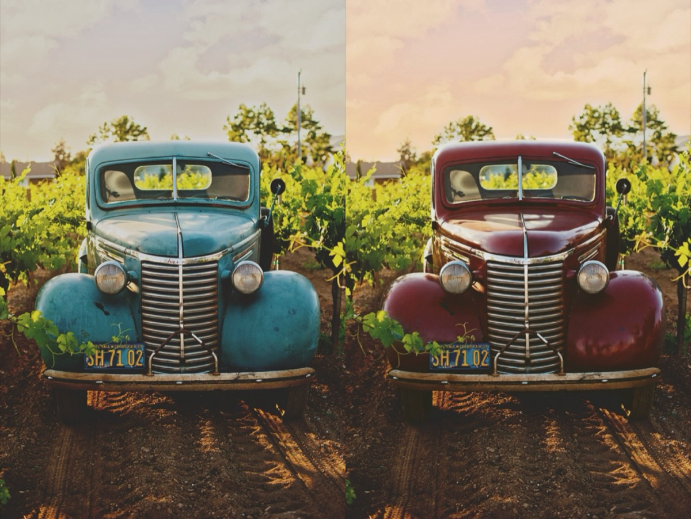
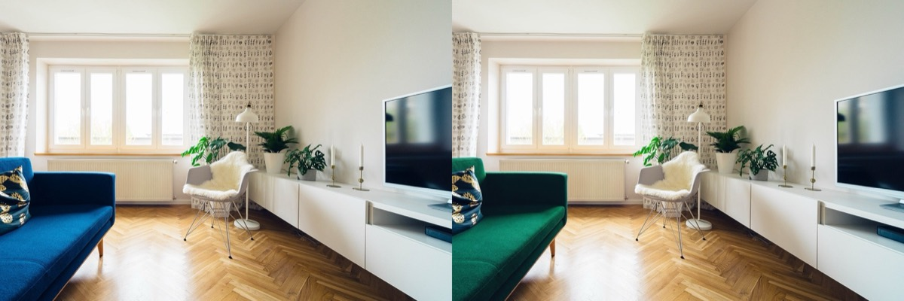
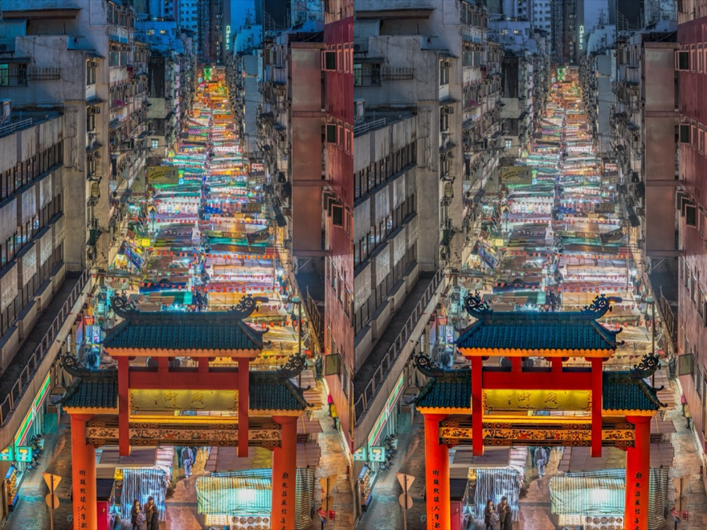
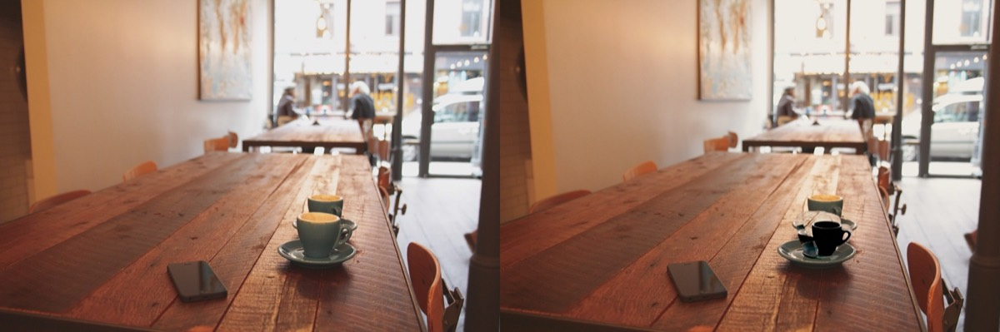
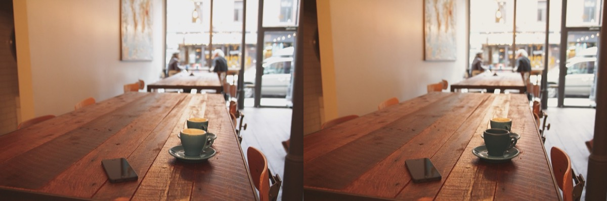
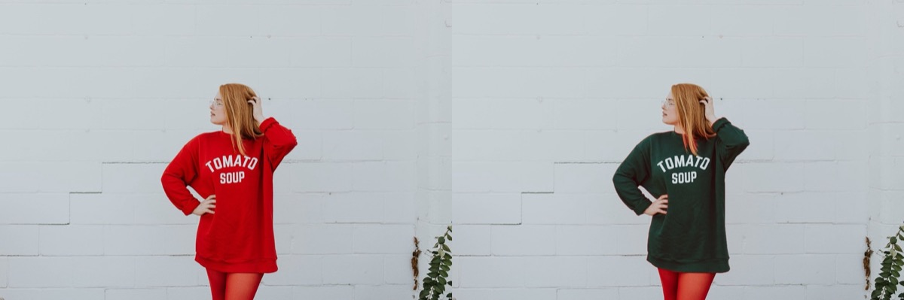
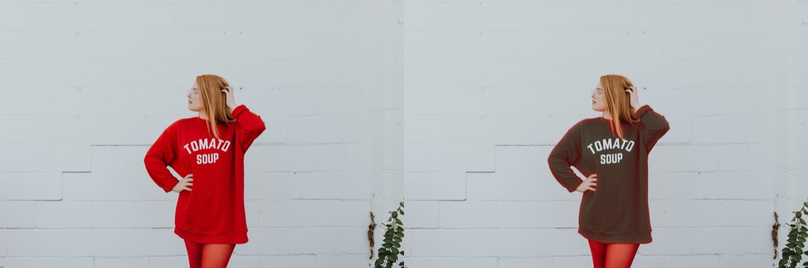
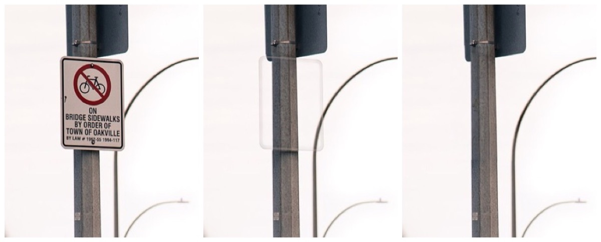
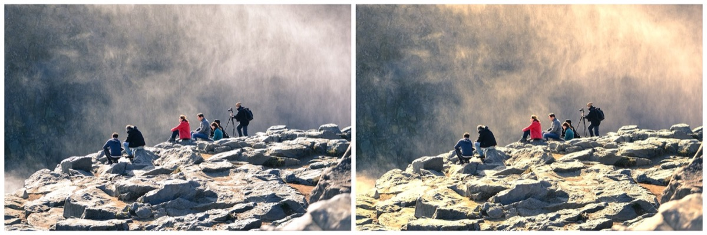
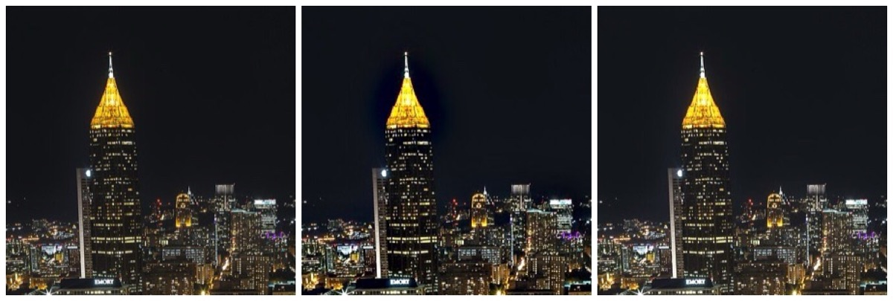

# Evaluation

Fifteen CC0 photos from [Fixtures/photos](../Fixtures/photos), each with one instruction from [Fixtures/instructions.json](../Fixtures/instructions.json), run with `lumen eval` against the Meta Model API. These are single runs on one machine; models answer differently from run to run, so read them as observations, not benchmarks.

```sh
export META_API_KEY=…
swift build -c release --product lumen
.build/release/lumen eval Fixtures/instructions.json --out results
```

Each case writes the result, a before/after comparison, the full trace (every plan, critique, model call and time) and a row in `results/summary.md`.

## October 26, 2026, after the fixes (commit c4378f9)

Muse Spark (`muse-spark-1.3`) planned and checked, SAM 3.1 selected, Muse Image (`muse-image-1.0`) redrew. Up to 12 steps and 2 revisions per case; previews at 1536 px.

**The critic was satisfied with all 15 results, after one revision in total.** Judged by eye, 10 meet the instruction cleanly and 5 are weaker. 66 model calls in all; 285 s of wall time, a median of 17 s per case.

| Case | Instruction | Layers | Revisions | Critic | Calls | Time | Judged by eye |
| --- | --- | ---: | ---: | --- | ---: | ---: | --- |
| blue-vintage-car-on-a-dirt-road | Make the truck a deep cherry red and give the sky a warm late-afternoon glow. | 2 | 0 | Satisfied | 6 | 31.2 s | Met. Glossy cherry red, chrome and plate untouched; warm sky. |
| city-at-night | Bring out the city lights and cool the shadows a little. | 1 | 0 | Satisfied | 2 | 9.4 s | Met, subtly. |
| coffee-in-montreal | Make the nearer cup matte black and the room a touch warmer. | 2 | 0 | Satisfied | 5 | 35.6 s | Partly. The cup is redrawn in place and much darker, but dark teal rather than black. |
| colorful-asian-street-market | Make the red gate stand out more and calm the busy colours around it. | 2 | 0 | Satisfied | 8 | 18.9 s | Met. SAM found no "gate" by name; the planner's box found it. |
| dressed-in-red | Change her red sweater to a forest green knit. | 1 | 0 | Satisfied | 5 | 19.4 s | Met. A real knit texture; the printed lettering went with the old sweater. A faint red fringe along one sleeve. |
| hooded-woman-in-snow | Make the snow a cleaner white without changing her skin. | 3 | 1 | Satisfied | 5 | 32.7 s | Met. Skin unchanged; the fleece lining brightened with the snow. |
| man-in-black-jacket-on-street | Turn his black jacket into a tan suede jacket. | 1 | 0 | Satisfied | 5 | 16.8 s | Met. Convincing suede, folds kept; the back print is gone, as a plain suede jacket would be. |
| jacket-with-a-hood | Make his jacket bright yellow. | 1 | 0 | Satisfied | 5 | 29.8 s | Met. Mustard-leaning yellow; droplets, drawstrings and folds kept. |
| kayaks-on-a-mountain-lake | Make the sky more dramatic and the water a deeper turquoise. | 2 | 0 | Satisfied | 4 | 9.8 s | Met. Clean edges where sky meets cloud. |
| living-room | Replace the blue sofa with a green velvet one. | 1 | 0 | Satisfied | 5 | 17.1 s | Met. Velvet sheen, cushion and legs kept. |
| man-in-denim-jacket-posing | Make it feel like golden hour. | 1 | 0 | Satisfied | 2 | 9.1 s | Partly. A warm, even cast more than low golden light. |
| man-on-bike-on-road | Remove the no-cycling sign from the pole. | 1 | 0 | Satisfied | 4 | 16.4 s | Mostly. The sign is gone; a faint outline of its edge remains on the pole. |
| man-walks-in-front-of-graffiti-wall | Make the graffiti wall black and white and keep him in colour. | 1 | 0 | Satisfied | 3 | 12.1 s | Met. |
| stockholm-man-with-headphones | Brighten his face a little and make the crowd behind him less distracting. | 2 | 0 | Satisfied | 4 | 18.7 s | Weak. Both changes are too slight to see easily. |
| sunset-beach-couple | Make the sunset more vivid. | 1 | 0 | Satisfied | 3 | 7.7 s | Mostly. Vivid, but the boosted horizon forms a band right of the couple. |

Model time per stage across all 15 cases: plan 66 s, select 35 s, redraw 85 s (7 redraws, 8.4–18.3 s each), critique 97 s.







## What the first run found, and what changed

The first full run, earlier the same day, had the critic satisfied with 11 of 15, after 8 revisions. Looking at its results led to four changes, each verified by running the affected cases again.

| Problem in the first run | Cause | Change |
| --- | --- | --- |
| The redrawn cup came back small and shifted, then two revisions stacked new redraws on the broken pixels. | Muse Image got a 224 × 166 crop; a live probe showed the same crop upscaled to 1024 px kept the cup in place. | Small crops are upscaled before generating; SAM checks each redraw and a poor overlap gets one more try; a redraw replaces the run's earlier redraw of the same region ([#12](https://github.com/mikheilkuzmidi/lumen/issues/12)). |
| "Red gate", "gate" and "archway" all found nothing; the gate was never adjusted. | SAM 3.1 finds the gate's pillars and roof by name, but not the whole gate. A box prompt over it found the gate at 0.87. | When a name finds nothing, the planner's box or points become SAM's object prompt ([#13](https://github.com/mikheilkuzmidi/lumen/issues/13)). |
| The sky's adjustment met the clouds in blocky steps. | The mask's coarse edge was used as it was, feathered under 1 px. | Masks are fitted to the photo with a guided filter, and widened where the photo is smooth ([#13](https://github.com/mikheilkuzmidi/lumen/issues/13)). |
| The graffiti case ended on a revision's own finish, with a stale "needs revision" verdict. | A revision's finish was believed without a look. | A revision with a redraw or a failure is checked again ([#12](https://github.com/mikheilkuzmidi/lumen/issues/12)). |





## October 27: what the maintainer's own photos found

Live runs on six of the maintainer's own photos (not in this repository) found four more problems. Each was fixed, and the same request was run again:

| Problem | Cause | Change |
| --- | --- | --- |
| "Bring out the city lights" made a night street darker. | Dehaze ran Core Image's contrast in linear light, where its 0.5 pivot is a light grey: every shadow went to black. | Dehaze works on sRGB-encoded values, and temperature moves in even mireds, so +35 warms about as much as −35 cools. The same request now brightens the street. |
| "A warm golden-hour glow" on a midday bridge came out bluer, then only warmer, and the critic accepted both. | There was no way to warm the highlights more than the shadows; vibrance made the blue sky bluer. | `highlightWarmth` and `shadowWarmth`; the planner is told what golden-hour light is, and the critic that only warmer isn't it. Now: gold highlights and a soft, warm sky. |
| Parked bicycles redrawn yellow had a smeared wheel and a smeared neighbour, and the critic called it clean. | The critic saw two 1024 px photos, where the smear was a few pixels. | Each region redrawn in a run goes to the critic close up, before and after. |
| Shirts redrawn blue on a black-and-white photo were saved grey, then had a dark band along their edges. | The export kept the photo's grey colour space; the redraw showed through SAM's mask grown past the shirt, where the generator drew a border. | A greyscale photo given colour is exported in sRGB; a recolour shows through SAM's mask fitted to the photo's own edges. |
## October 27, evening: retries, named redraws and a measured critique (commit 7a75068)

The same 15 cases, run again with these changes:
- Meta calls retried after a rate limit or a brief outage.
- Muse Image told which thing to change and where.
- Removals given more room and checked by SAM.
- The critic given each changed region's colour, measured before and after.

Muse Spark, SAM 3.1 and Muse Image as above; previews at 1024 px, up to 12 steps and 2 revisions per case.

**The critic was satisfied with all 15, after one revision in total. Judged by eye, 12 meet the instruction cleanly and 3 are weaker**; on October 26 it was 10 and 5. 66 model calls, 280 s, $0.43.

| Case | Layers | Revisions | Calls | Time | Judged by eye |
| --- | ---: | ---: | ---: | ---: | --- |
| blue-vintage-car-on-a-dirt-road | 2 | 0 | 6 | 23.9 s | Met. Deep cherry red, chrome and patina kept; a warm, peachy sky. |
| city-at-night | 1 | 0 | 2 | 8.0 s | Mostly. Brighter, crisper lights, but clarity left a dark rim round the lit spire. |
| coffee-in-montreal | 2 | 0 | 5 | 29.5 s | Met. The cup is matte black in place (lightness 9), the room warmer. |
| colorful-asian-street-market | 3 | 1 | 9 | 34.0 s | Met. The critic sent it back because the surroundings had changed by only 1.4; the second pass calmed them. |
| dressed-in-red | 1 | 0 | 5 | 20.6 s | Met. Forest green knit, lettering kept, no red rim. |
| hooded-woman-in-snow | 1 | 0 | 3 | 9.7 s | Met. Clean white snow (lightness 92 to 100), skin unchanged (0.2). |
| man-in-black-jacket-on-street | 1 | 0 | 5 | 21.2 s | Met. Tan suede, the eagle artwork kept. |
| jacket-with-a-hood | 1 | 0 | 5 | 26.6 s | Met. Bright yellow, droplets and folds kept. |
| kayaks-on-a-mountain-lake | 2 | 0 | 4 | 16.8 s | Met. |
| living-room | 1 | 0 | 5 | 21.0 s | Met. Emerald green velvet. |
| man-in-denim-jacket-posing | 1 | 0 | 2 | 6.8 s | Partly. Warm and golden, but not low, directional light. |
| man-on-bike-on-road | 1 | 0 | 5 | 18.8 s | Met. The sign is gone with no outline; the pole and lamp posts carry on. |
| man-walks-in-front-of-graffiti-wall | 1 | 0 | 3 | 18.1 s | Met. |
| stockholm-man-with-headphones | 2 | 0 | 4 | 13.9 s | Met. The face 5 lighter, visible but natural; the crowd softer and greyer. On October 26 both were too slight to see. |
| sunset-beach-couple | 1 | 0 | 3 | 10.8 s | Mostly. Vivid, but the boosted horizon still forms an orange band right of the couple. |

Model time per stage: plan 75 s, select 37 s, redraw 73 s, remove 9 s, critique 83 s.



### What these runs found, and what changed

| Problem | Cause | Change |
| --- | --- | --- |
| A removed sign left a faint outline, and the critic called it "the region overlay". | Muse Image's patch was clean. The patch was blended in through an edge softened inward from its mask, which reached only 1% past the sign, so the sign's rim showed through ([#25](https://github.com/mikheilkuzmidi/lumen/issues/25)). | A removal's mask reaches 6% of the crop past the thing and is softened there. The prompt names the thing and where it is, the crop is three times its size, and SAM looks for it again afterwards. |
| The removal prompt was "remove the selected object", and Muse Image takes no mask. | It never said which object. A probe with a second, marked image turned the sign into a black box, so that isn't used. | The prompt names the thing and its place in the crop: "Remove the whole no-cycling sign in the centre of this picture, every part of it." |
| The first run of the day, before the fix below, redrew the red sweater dark brown with a red rim, three times. The critic rejected each one. | Muse Image drew a clean green. SAM's mask missed the sweater's edge, so the ring where the generator's colour drift is measured held red sweater in the photo and green in the redraw, and the whole patch was moved toward red ([#29](https://github.com/mikheilkuzmidi/lumen/issues/29)). | The drift is measured a little outside the mask, only where photo and redraw agree. The compositor no longer softens a patch's edge inward, since a recolour's mask is already held to the photo's edges. |
| A Meta rate limit or outage failed a step. | No retries ([#24](https://github.com/mikheilkuzmidi/lumen/issues/24)). | Sent again at most twice, after the wait a 429 asks for (up to 20 s), or after about 1 s and 2 s. |





### Does the critic read the measurements?

A cup darkened to charcoal (lightness 21, chroma 7) and labelled "redrawn as a matte black ceramic cup" was sent to the critic four times with measurements and four times without, against "Make the nearer cup matte black." Without them it accepted the cup once in four. With them it rejected it four times in four, asking for a stronger redraw ("still charcoal, not true matte black, which needs lightness under ~15").

A face brightened by only +0.05 stop (change 0.5) was rejected both ways: the critic saw that from the label and the photos. The October 26 cup that looked "dark teal rather than black" reads lightness 20 and is now named charcoal; the redraw in this run reads 9.

### Relighting with Muse Image: tried and dropped

Golden hour stops at a warm grade, because tone and colour settings can't make low, directional sunlight. Asking Muse Image to relight the whole photo gave convincing golden-hour pictures, but redrawn ones: new clouds, a shifted palm and truck, a slightly different face. Their edge correlation with the original after the best small shift was 0.75 and 0.49. Keeping only their light (the original times the relit photo's smoothed light over its own) gave a blotchy yellow-green sky on the overcast beach and a muddy truck photo, with or without a guided filter. Nothing was added ([#27](https://github.com/mikheilkuzmidi/lumen/issues/27)).

## October 27, late: the remaining flaws (commit 601d590)

The three weaker results above, and two flaws found while fixing them, each fixed and the same request run again. Then all 15 cases ran once more: **the critic was satisfied with all 15, after two revisions; by eye, 14 meet the instruction cleanly**, against 12 earlier the same evening and 10 on October 26. 67 model calls, 297 s, $0.51.

| Problem | Cause | Change | Now |
| --- | --- | --- | --- |
| A dark rim round the city's lit spire ([#30](https://github.com/mikheilkuzmidi/lumen/issues/30)). | Clarity was an unsharp mask in linear light; beside a bright edge it pushed the near-black sky below zero (a sky at 20 went to −16). | Clarity is local contrast against a guided filter of the lightness, on encoded values. | No rim. In a test the same sky dips to 17 at clarity 60; faint texture still gains about 30% contrast at 30. |
| A flat orange band beside the sunset couple ([#30](https://github.com/mikheilkuzmidi/lumen/issues/30)). | Saturation +30 in linear light took the glow's blue from 79 to 8 on its own, and below zero with contrast. | Saturation raises each channel's share of the lightness on encoded values; no channel can pass zero. | A smooth, vivid glow; the blue eases to 64. |
| Golden hour as an even warm cast ([#31](https://github.com/mikheilkuzmidi/lumen/issues/31)). | Tone and colour settings have no direction. | A selection can be a gradient, built on the Mac; the planner lights golden hour from the side the light comes from. | On four photos the planner picked a side for each (left for three, right for a street lit on that side) and the light falls across the frame. Still no new shadows. |
| The night city's first pass sent back as too slight ([#32](https://github.com/mikheilkuzmidi/lumen/issues/32)). | The whole photo's measured colour is its middle, black sky, which moved 1.6. | Measurements also give the brightest and darkest tenth. | The pass is accepted, citing the lights going from 58 to 67. |
| A small smear missed ([#33](https://github.com/mikheilkuzmidi/lumen/issues/33)). | Probed with a headlight smeared on a real redraw of the truck: missed three times in three from the whole photos, two in three with the close-up. | The host compares each redrawn close-up's fine detail with its before and names places that kept under 30%. | Caught three times in three, naming the headlight; the clean redraw named nothing and was accepted three in three. |
| The truck's fender kept a teal rim and a teal underside ([#34](https://github.com/mikheilkuzmidi/lumen/issues/34)). | SAM's mask, held to the photo's edges, stopped short of them; Muse Image had recoloured them. | A recolour's mask grows into connected pixels of the thing's own colour, at most 3% of the crop out: by hue for a colourful thing, by lightness for a grey one. | Red to the rim and underneath; the black-and-white photo's shirts still stop cleanly at the backpack. |

The weaker one was golden hour (man-in-denim-jacket-posing): warm light fell from one side, but with no long shadows. That and straightening were then fixed too:

| Problem | Cause | Change | Now |
| --- | --- | --- | --- |
| Golden hour had no long low-sun shadows ([#35](https://github.com/mikheilkuzmidi/lumen/issues/35)). | Tone and colour have no shape; relighting with Muse Image redraws the scene ([#27](https://github.com/mikheilkuzmidi/lumen/issues/27)). | A selection can be the shadow what SAM finds casts on the ground: its silhouette laid from its base toward a tip the planner picks away from the light, each figure of a group from its own feet. Drawn masks (shadows, gradients) are used as drawn, not fitted to the photo's edges. | On five photos the planner cast a palm's shadow across the sand, a truck's onto the sunlit ruts (203 to 162), hikers' across the rocks and a cyclist's along the road (141 to 120), each away from its light. On dark dirt the shade barely shows, as in life. |
| Straightening depended on the model and changed between runs ([#36](https://github.com/mikheilkuzmidi/lumen/issues/36)). | Vision reads perspective, a receding shore or a slope as tilt, and the reviewer's look varies: two runs over the 126 local photos straightened 12 and 15, including a city above a strait and a fountain that weren't tilted, and never the tilted sea snapshot. | The Mac finds the photo's long straight lines (a Hough transform over its edges). Walls and poles, where there are enough, must lean with the measured tilt; otherwise a horizon or shoreline must; the reviewer can only stop a close-up's level line from deciding. Nothing past 7°. | Two runs straighten the same 11 photos by the same angles, each right by eye, including the sea snapshot (6.8°); the library's tilted lake and street are levelled. Photoeditor's library editing measures the same lines and levelled the same photos live. |





## October 28–29: the maintainer's own photos, and person styles (commits db8453e to b8164d3)

The maintainer ran Lumen on 24 of their own photos (16 from their Unsplash profile, 8 local) and named what was off. Each was fixed, tested and run again on the same photo; those photos stay out of the repository.

| Problem | Cause | Change | Now |
| --- | --- | --- | --- |
| Orange flowers made purple: one of eight changed ([#37](https://github.com/mikheilkuzmidi/lumen/issues/37)). | The planner pointed at a few flowers; small ones it missed were left out. | A selection can be every one SAM finds, kept by colour family; the redraw names how many. | All 8 poppies purple; the red flowers beside them kept. |
| A coat redrawn navy kept a red outline; a skier's jacket kept red piping ([#37](https://github.com/mikheilkuzmidi/lumen/issues/37)). | The mask stopped short of a tab and a soft edge; the planner asked to keep trims. | The mask grows over every main colour of the thing, firms its colourful soft edge and adds a tinted ring; trims in the old colour are recoloured, other materials (fur) keep theirs. | Red pixels on the coat 219 → 7; the jacket fully blue, its fur white. |
| T-shirts asked for in forest green came out black with a green tint ([#37](https://github.com/mikheilkuzmidi/lumen/issues/37)). | Muse Image keeps a dark thing's darkness under a hint of colour. | Black, white or grey things are asked for fully dyed; a named hue must measure chroma 20 or more. | A real forest green. |
| A car in a black-and-white photo stayed black ([#38](https://github.com/mikheilkuzmidi/lumen/issues/38)). | The planner's point was 0.001 outside the car's box. | The thing a point just misses is kept when it is clearly the nearest. | Deep red. |
| A sharp storm photo was flagged as blurred ([#39](https://github.com/mikheilkuzmidi/lumen/issues/39)). | Soft clouds over a crisp town read as blurred in a contact sheet. | A blur flag holds only when no part of the photo is sharp (its sharpest tiles, at 1536 px). | Not flagged; a shaken frame (0.031) and a pocket shot (0.002) still are. |
| A thin red line under the coat's collar tab and a pink rim on its cuff, at 3872 px ([#40](https://github.com/mikheilkuzmidi/lumen/issues/40)). | The patch was blended through a feather 0.3% of the patch wide, fading the coat's last 10 px back to red; enlarged patches got the old colour's detail back per channel. | The feather only smooths the mask's own pixel steps; detail comes back as lightness only. | Red let through at the edge ~1,890 → ~90 pixels; no line at 1:1. |
| In Photoeditor, recolours had none of this ([#41](https://github.com/mikheilkuzmidi/lumen/issues/41)). | The app's host implemented no fitting, growth or measuring. | `EditSupport` works them out from any render; the app's host uses it. | The same masks and numbers in the app. |
| The critic rejected gentle edits of overcast skies for "a white grid" ([#42](https://github.com/mikheilkuzmidi/lumen/issues/42)). | Real, in the 1024 px preview only: scaling down left rows, columns and corners a hair under opaque, and saturation's divide made them white or black. | Resizing is clamped and opaque; saturation makes its input opaque first. | Flat skies in previews; saturation +3 alone had reproduced it. |

| Golden hour on a man sitting on a bench darkened his legs and hands ([#49](https://github.com/mikheilkuzmidi/lumen/issues/49)). | The bench runs off the bottom of the photo, so its shadow was laid from the frame's edge onto whatever was beside it. | A subject that reaches the bottom edge casts no shadow, and the agent says why. | The bench and two children cut off at the bottom are skipped; a tree's shadow is cast instead; a grandfather's and child's shadow falls on the wet sand, faint as shade on dark sand is. |
| Athletic and gym-built on the maintainer, standing between two friends, widened his head and face ([#51](https://github.com/mikheilkuzmidi/lumen/issues/51)). | Half-length, with his friends' arms over his shoulders, his hair was the widest row where shoulders usually are; the warp widened it and pinched his chest. The muscle redraw redrew his face and hair, and the critic, told a warp changed the colours by 0.2, called a correct reshape "identical". | SAM finds the face first: the shoulders are looked for 0.3 to 1.6 face heights below the chin and the waist 2.3 below, standing or sitting; nothing at or above the chin moves or is redrawn; a gym-built redraw may widen the waist by 8% at most; the critic judges a body style by its outline and Shape note. | His face exactly as it was and his torso visibly broader; a redraw that widened his waist 35% was left out. Athletic and gym-built pass on all three of his photos, and a seated man's thighs and hands are no longer narrowed. |
| In Studio's library, a photo whose edit recovered showed a red Failed badge ([#53](https://github.com/mikheilkuzmidi/lumen/issues/53)). | SAM found nothing for "shirts" on one photo, so the redraw was skipped; the revision found three t-shirts by another name and the critic was satisfied, but any failure during an edit failed the photo. | A step that failed fails the photo only when its last critique isn't satisfied; the skipped step stays in its notes. | The photo shows Edited, not Failed. |

### Person styles ([#43](https://github.com/mikheilkuzmidi/lumen/issues/43))

A style step redraws only a person's face, head or body: chad, gigachad, Hollywood glow-up, beard, smile, aviator shades, zombie make-up, 30 years older, platinum blonde, athletic, gym-built, and effects (dramatic black and white, main character, vintage film, neon night, red carpet glow). Reshaping and ageing are for adults only. Run once each on the maintainer's photos of adults:

- **Worked, judged by eye:** shades, beard, smile (on one of two people), zombie make-up, platinum blonde, main character, neon night, 30 years older, and chad and gigachad on three photos each (jaw +7% to +11%). Subtle: Hollywood, vintage.
- **Gym-built** worked at first only where the arms were bare: under a loose shirt the redraw moved the shoulders by 1% in three tries, and beside his wife Muse Image's filter declined the prompt twice ([#44](https://github.com/mikheilkuzmidi/lumen/issues/44)). It now reshapes first (shoulders +12%, waist −4%) and redraws for the muscles. Over loose clothes that redraw still overshot (shoulders +21%) or smeared, so on a reshaped body it is left out when it isn't believable ([#46](https://github.com/mikheilkuzmidi/lumen/issues/46)). It passes on a man in a T-shirt and one in a sweater. On a man holding a big fish against his chest, the warp bent the fish; a style step now names what the person holds to keep, and the warp and the redraw leave it alone ([#47](https://github.com/mikheilkuzmidi/lumen/issues/47)). The fish then stayed as it was, but gym-built still changed nothing: his arms and the fish were the widest part of his outline and were taken for his shoulders, where the warp had to hold still. The body is now measured without what it holds, and gym-built's reshape is a little stronger (shoulders +15%, waist −5%) ([#48](https://github.com/mikheilkuzmidi/lumen/issues/48)); it passes on all three photos, the fish untouched.
- **The warp's texture:** an athletic build was turned down three times for smearing the twigs beside a man's waist; the warp blended two pixels per moved one (81% of fine texture's contrast kept). Catmull-Rom keeps 94% ([#45](https://github.com/mikheilkuzmidi/lumen/issues/45)), and the photo passed its first check. Athletic passed its checks on seven photos, including a woman in a winter coat, one of three friends, a man holding a fish and a father holding his son, each held thing and neighbour kept as they were. The three-friends result was wrong all the same: it widened the man's head, which the critic missed (#51).
- **Children:** asked for an athletic body for a boy skiing and a chad face for a boy on a lawn, the planner planned nothing for either and said why.
- **Bodies:** asked for "slightly broader shoulders and a slimmer waist", Muse Image changed a body by 1–2% or not at all, three times in three; told outright with amounts it sometimes did. An athletic build is now a warp, shoulders +10% and waist −10% about the body's own centre line, fading out a quarter of a shoulder width past it: exact and natural, but subtle in a loose sweater, and it nudges a person standing close beside.
- **Face tone:** on a bluish phone photo Muse Image drew the face warmer, twice even when told not to, leaving a seam down the neck. The redraw now gets the photo's own colour cast back under the face's mask, keeping its own lightness; the seam is down to a faint transition.
- **Dropped:** a 1980s mullet, which doesn't show from the front; platinum blonde took its place.
- **Too subtle, then fixed ([#52](https://github.com/mikheilkuzmidi/lumen/issues/52)):** run again on the maintainer, Hollywood came back identical three times in three, chad was light stubble on two photos of three, and 30 years older greyed the hair of a face as young as before. SAM's "head" on him was only his hair, so the redraw never reached his eyes or mouth, and the prompt kept "exactly the photo's skin tone". Hollywood now comes with its own soft "red carpet glow" on the person; chad names its amounts and is asked once more below +5% at the jaw; an ageing head takes in the face, and styles that recolour skin or hair aren't held to its tone. Each now shows: groomed brows and even skin, a firmer jaw with stubble, crow's feet and aged skin, on the same face.
- **Faces:** a face reached 10% of the crop past SAM's mask at first, and a head drawn a little to one side showed twice through the soft edge as a pale arc; 5% removed it.

## A whole library
`Fixtures/library` is a small CC0 shoot of 16 photos:

- people in T-shirts of several colours;
- a black-and-white photo and silhouettes;
- photos with nobody in them;
- a shaken frame and a pocket shot;
- two horizons tilted on purpose (+4° and −3°).
```sh
lumen batch Fixtures/library "Make everyone's T-shirts blue" --out results --mode autonomous
```

The last run on October 27 took 47 model calls and 393 s, and cost $0.43. Each part, judged by eye:

| Part | Result |
| --- | --- |
| Misfires | Both flagged (the shaken frame, the pocket shot) and left out. |
| Straightening | The lake (−3.6°), the street (+1.8°) and the grain elevators (+2.1°) levelled; the café, the city and the forest left alone. |
| Questions | Whether to straighten, answered in autonomous mode with the recommendation; in other runs, the shirt style, the black-and-white photo, partly hidden people, the shade of blue. |
| Shirts | Four photos planned and recoloured: all four T-shirts on the hilltop, both in the forest, the three women's tops by the grain elevators, and the boys' shirts in the black-and-white photo. That photo was exported grey, which led to the last change below. |

Lumen Studio's Library (plan-first, 37 calls) and Photoeditor's prompt bar (plan-first, 34 calls) ran the same library with the same agent.

Each of these runs found something, and each was fixed and run again:

| Problem found live | Change |
| --- | --- |
| Auto darkened high-key photos by a full stop and stretched whites and blacks on almost every photo. | A gentle Auto: exposure moves only outside 0.35–0.6 median lightness, at most 0.7 stop. |
| Core Image found no tilt in either tilted photo; Vision then read perspective lines in a café and a forest as tilt. | Vision measures; the reviewer says whether the camera was visibly tilted; at most 6°. |
| A white T-shirt stayed white: SAM didn't find it by name, so its neighbour's blue shirt was selected each time. | The planner's point or box decides which segment is meant; otherwise they become SAM's own prompt. |
| A recoloured shirt was checked for its old colour, called "moved" and redrawn again. | The redraw check searches without colour words, and a match outside the region counts as no check. |
| The reviewer matched only one shirt photo to the instruction, so nothing was recoloured. | Every photo goes to Muse Wonder with the reviewer's impression as a hint; the planner decides. |
| "Blue with the same subtle pattern" left a pale patterned shirt as it was. | Colour changes are asked for from what to what. |
| After the portrait rule below, the reviewer called the tilted lake and street level: an October 27 run left both crooked. A rule that water is always level fixed three review-only runs, but not a run with an instruction. | The reviewer also names the line that should be level: horizon, water, building or none. A contact sheet shows that plainly where a 3° tilt is hard to see. A measured tilt with a horizon or water line is straightened; with none, it is not. |
| Muse Wonder planned the T-shirts on one photo of four. It decided from the reviewer's few-word descriptions, which left the shirts out. | Photos the reviewer matched from the image stay in unless their description rules the instruction out. |
| The boys' shirts in the black-and-white photo were redrawn blue but exported grey: the export kept the source's grey colour space. | A greyscale photo that an edit gives colour is exported in sRGB. |
## At scale

The project's 126 local test photos cover portraits, faces, groups, pets, landscapes, cities, water, snow, night, indoor flash and studio. They are the maintainer's own test set, so they are not in the repository, and only the numbers are reported here.

| Run | What it did | Time | Calls | Cost |
| --- | --- | --- | --- | --- |
| Base pass, autonomous, before the reviewer fix | Reviewed all 126; flagged 6; levelled 12; 9 closer looks | 120.5 s | 28 | $0.47 |
| Review and straightening only, after the fix (commit 0022e59) | Reviewed all 126; flagged none; levelled 6 landscapes, harbours and water scenes | 63.1 s | 7 | $0.21 |

The first run flagged six good photos as "badly blurred": a baby's portrait, a child in soft light, a family on a sofa, storm clouds, a beagle and sleeping puppies. Their soft backgrounds and soft light had lowered the whole-frame sharpness that the reviewer is shown. It also levelled portraits by up to 5.7°.

The reviewer is now told three things:

- low sharpness alone is never a misfire;
- verticals that lean in a shot taken upward are perspective, not tilt;
- a portrait counts as tilted only when a horizon or building edge behind the person is clearly off.

Automatic straightening also stops at 5°. In the second run none of the six was flagged and no portrait was rotated. It also left one genuinely tilted harbour view alone, so it errs on the side of not straightening.

At the second run's rate, reviewing 1,000 photos takes about 8 minutes and about $1.70. Edits that redraw something come on top, at about 5 calls per photo.
## Follow-ups and undo

A gated live test (`LUMEN_LIVE=1 swift test --filter followsUpOnTheSameEdit`) runs three instructions on one photo. On October 26 it took 49 s:

1. "Make his jacket bright yellow": select, redraw, satisfied.
2. "A bit less yellow": no new selection; saturation −25 on the remembered jacket.
3. "Undo that": reverts only that adjustment and ends without a critique.

The first run of this test found the critic asking to undo the earlier redraw too, because it did not know what "that" referred to. The critic now gets the earlier instructions.

The same three instructions pass in Photoeditor's prompt bar through its scripted QA (a private repository).

## Open weights

Muse Glimmer on this Mac completed the jacket instruction in about 4.5 minutes, against 27 s with Muse Spark; see [open-weights.md](open-weights.md). Muse Spark Open has not been run: no hosting credits were used.

## Limits of this evaluation

- One run per case. A second run of the same case can plan differently.
- The instructions were written for these photos and these models.
- Judgments by eye are one person's.
- The critic is the same model as the planner, so "Satisfied" is the system's own verdict; the column beside it is the independent one.
